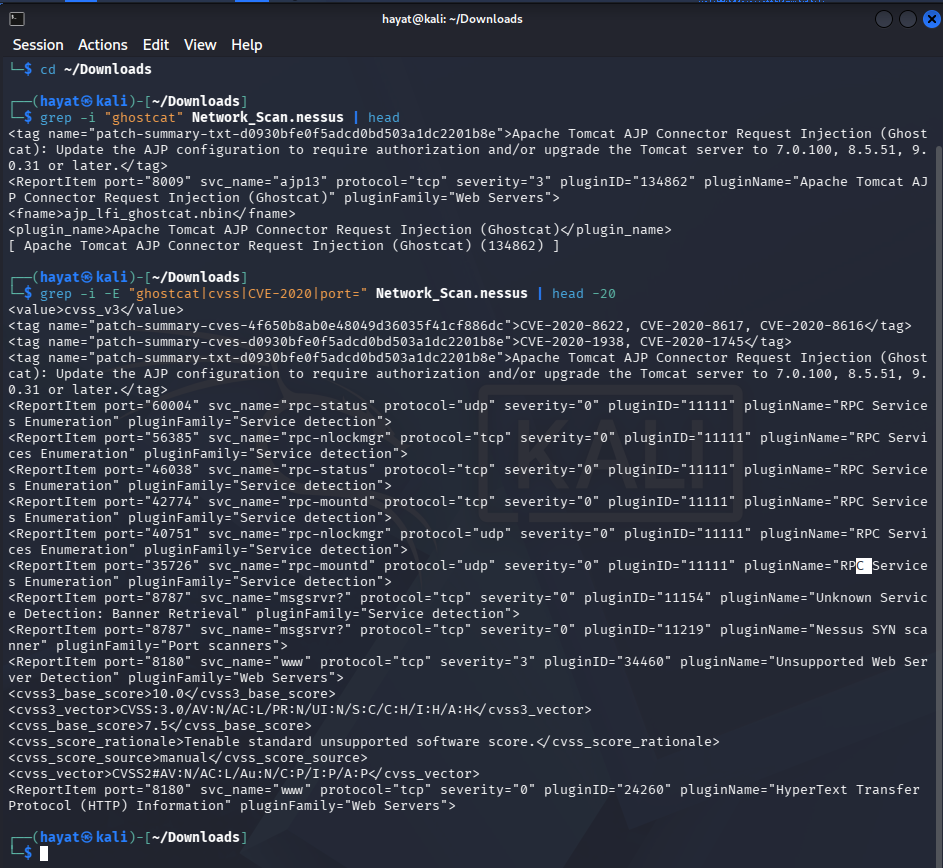
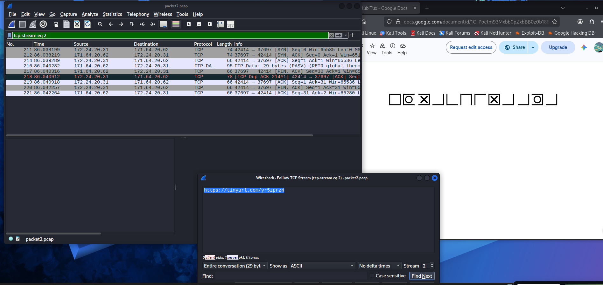
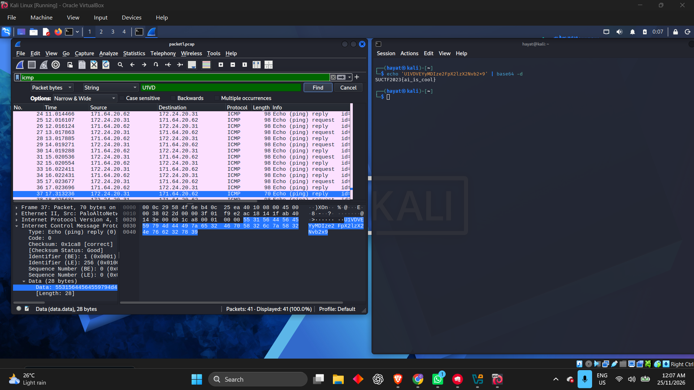
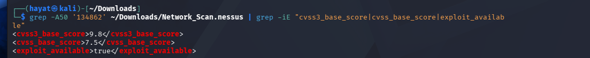

# Lab Week 6 & 7 — File Analysis (Scanning Result)

**Name:** _your name_
**Class:** _your class / student ID_
**Course:** IKB21004 & IKB21403 — Vulnerability Analysis
**Task:** File Analysis – Scanning Result

> All analysis was performed on supplied lab files (packet captures, an Nmap output, and a
> Nessus scan result) in a Kali Linux environment, for educational purposes only.

---

## Question 1 — Analyse packet1.pcap and find the flag

**Tool:** Wireshark

**Steps:**
1. Open `packet1.pcap` in Wireshark.
2. Apply display filter: `icmp` → 41 ICMP (ping) packets.
3. All packets carry the same ping payload except one. Use **Edit → Find Packet → String → Packet bytes**, search `U1VD`.
4. The matching ICMP packet's **Data** field contains a Base64 string:
   ```
   U1VDVEYyMDIze2FpX2lzX2Nvb2x9
   ```
5. Decode the Base64 in a terminal:
   ```bash
   echo 'U1VDVEYyMDIze2FpX2lzX2Nvb2x9' | base64 -d
   ```

**Flag:**
```
SUCTF2023{ai_is_cool}
```



---

## Question 2 — Analyse packet2.pcap and find the flag

**Tool:** Wireshark

**Steps:**
1. Open `packet2.pcap` in Wireshark.
2. Apply display filter: `ftp`. An **anonymous FTP** session is seen downloading a file:
   ```
   USER anonymous
   RETR global_thermonuclear_war.gamerules.txt
   227 Entering Passive Mode (171,64,20,62,147,65)   -> data port 147*256+65 = 37697
   ```
3. To read the transferred file content, filter the data connection:
   ```
   tcp.port == 37697
   ```
   then right-click → **Follow → TCP Stream**.
4. The exfiltrated file content is a URL:
   ```
   https://tinyurl.com/yr5zprz4
   ```

**Finding:** A file (`global_thermonuclear_war.gamerules.txt`) was exfiltrated over anonymous FTP; its content is the link above, which leads to the final flag.



---

## Question 3 — Interpret an Nmap Output

```
PORT     STATE SERVICE     VERSION
21/tcp   open  ftp         vsftpd 2.3.4
22/tcp   open  ssh         OpenSSH 5.3p1
80/tcp   open  http        Apache 2.2.8
139/tcp  open  netbios-ssn
445/tcp  open  microsoft-ds Windows 7 Professional 7601 Service Pack 1
```

**1. What can an attacker do with each port?**

| Port | Service | Attacker action |
|---|---|---|
| 21 | FTP (vsftpd 2.3.4) | Anonymous login, brute-force, file access, **backdoor RCE** |
| 22 | SSH (OpenSSH 5.3p1) | Credential brute-force, username enumeration |
| 80 | HTTP (Apache 2.2.8) | Web attacks, directory enumeration, exploit old Apache |
| 139/445 | SMB (Windows 7 SP1) | Share enumeration, null sessions, **EternalBlue** |

**2. Likely vulnerabilities based on version:**
- **vsftpd 2.3.4** → backdoor command execution — **CVE-2011-2523** (instant root)
- **Apache 2.2.8** → outdated, multiple CVEs
- **OpenSSH 5.3p1** → username enumeration / dated
- **Windows 7 SP1 SMB** → **EternalBlue — MS17-010 (CVE-2017-0144)**

**3. Highest risk and why:**
**vsftpd 2.3.4 (port 21)** — its backdoor gives an **unauthenticated root shell** and is trivial to trigger (CVSS ~10). *(SMB EternalBlue on 445 is also critical → SYSTEM.)*

**4. Attack path:**
Exploit the vsftpd 2.3.4 backdoor → direct **root** shell; OR exploit EternalBlue on port 445 → **SYSTEM** on the Windows host → data theft / lateral movement.

**5. Remediation:**
Patch/upgrade all services (vsftpd, Apache, OpenSSH, apply MS17-010), disable anonymous FTP, disable unused services (SMB/NetBIOS), apply firewall rules and hardened configurations.

---

## Question 4 — Identify the OS (OS Fingerprinting via TTL)

Each OS has a default TTL value, so the TTL in a ping/ICMP reply reveals the OS family.

| Image | Observed TTL | Operating System |
|---|---|---|
| Image 1 | `ttl=64` | **Linux / Unix** |
| Image 2 | `Time to live: 255` | **Network device (router/switch) / Unix (e.g. Solaris, Cisco)** |
| Image 3 | `ttl=128` | **Windows** |

*Note:* TTL decreases by 1 per hop, so 64 / 128 / 255 are the original (default) values.

---

## Question 5 — Analyse the Nessus file (Ghostcat)

**Tool:** Nessus result file (`Network_Scan.nessus`) analysed in Kali.

The critical finding **"Apache Tomcat AJP Connector Request Injection (Ghostcat)"** (pluginID 134862) was located:

```bash
grep -i "ghostcat" Network_Scan.nessus
grep -A50 '134862' Network_Scan.nessus | grep -iE "cvss3_base_score|cvss_base_score|exploit_available"
```

**Answers:**

| # | Question | Answer |
|---|---|---|
| 1 | Affected port | **8009** |
| 2 | Affected protocol | **AJP (ajp13) over TCP** |
| 3 | CVSS score | **9.8** (CVSSv3) — Critical *(CVSSv2: 7.5)* |
| 4 | Exploit available? | **Yes** — `exploit_available=true`; Metasploit module + Exploit-DB PoCs |
| 5 | CVE | **CVE-2020-1938** (also CVE-2020-1745) |





---

## Summary

| Question | Result |
|---|---|
| Q1 | Flag: `SUCTF2023{ai_is_cool}` (Base64 inside an ICMP packet) |
| Q2 | Anonymous FTP file exfiltration → `https://tinyurl.com/yr5zprz4` |
| Q3 | Highest risk: vsftpd 2.3.4 backdoor (CVE-2011-2523); SMB EternalBlue (MS17-010) |
| Q4 | TTL 64 = Linux, 255 = network device, 128 = Windows |
| Q5 | Ghostcat — port 8009, AJP/TCP, CVSS 9.8, exploit available, CVE-2020-1938 |
